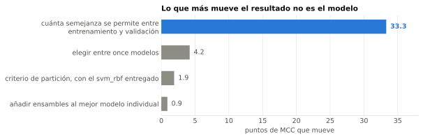
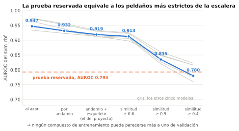
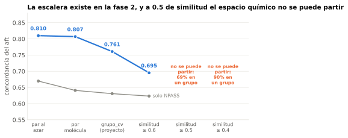
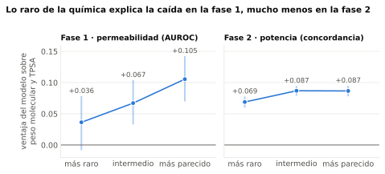
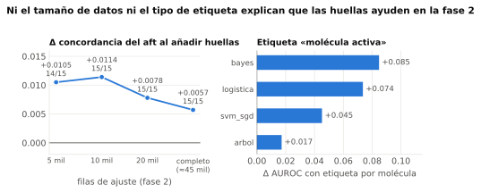
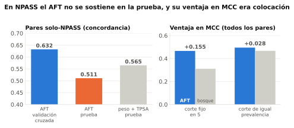
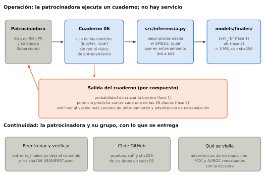
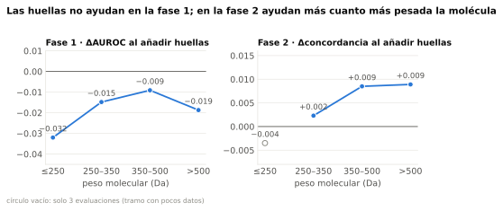
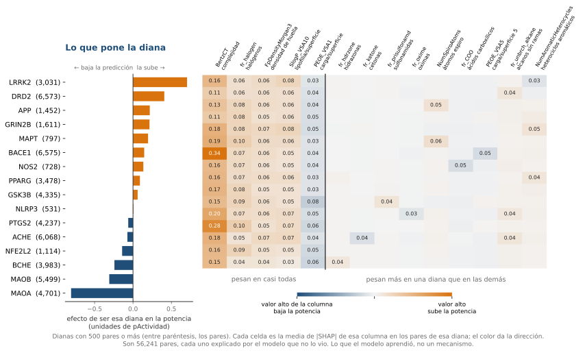

# Bioactive: cuánto confiar en una predicción depende de la molécula, no del modelo

**Nota de trabajo, no llega al `.tex`.** Borrador para la entrega del **13 de noviembre de 2026**; el plazo
del curso es el 15. El cuerpo lleva un hilo y el detalle va a anexos. Cada cifra sale de una corrida registrada
en `experimentos/` y las figuras se generan con un script del repositorio. El cuerpo, del título a las
referencias, debe quedar dentro de las 12 a 18 páginas que pide la rúbrica, así que lo que se añada conviene
que sustituya.

## Resumen

Queríamos saber qué tan lejos podía llegar un modelo para priorizar compuestos naturales con potencial
neuroprotector, y encontramos que casi nunca era el modelo lo que importaba. Entrenamos dos modelos
en paralelo: uno que decide si una molécula cruza la barrera hematoencefálica (fase 1) y otro que estima su
potencia contra 26 dianas del sistema nervioso central, usando también las mediciones censuradas (fase 2).
Comparamos once modelos, de una regresión logística a ensambles; ninguno mejoró de forma distinguible al mejor
modelo individual: entre ellos hay 4.2 puntos de MCC (una medida que pesa los aciertos y errores de las dos clases, entre −1 y 1), contra 33.3 puntos que se
pierden al exigir que lo evaluado se parezca menos a lo entrenado. En la prueba reservada el mejor modelo rindió
peor de lo que su semejanza predecía (AUROC 0.79 en lugar de 0.89), y tres formas distintas de enseñarle química
rara no cerraron la brecha. Lo que sí movió el resultado fue el corte de decisión: igualar la tasa de compuestos
declarados permeables a la prevalencia esperada sube el MCC de 0.34 a 0.41. Las huellas moleculares ayudaron en la
fase 2 y no en la 1, y en los 117 pares de naturales de la prueba el orden de potencia (0.511) no se distingue de una
línea base de tamaño y polaridad (0.565). Concluimos que la confianza en una predicción depende de cuán nueva es la molécula, y que esa
distancia conviene medirla y mostrarla junto con cada predicción.

*Figura 1. Cada barra viene de una corrida distinta, con otro propósito; indican el orden de
magnitud, no miden el efecto de cada factor por separado.*

## 1. Contexto de negocio y problema

### 1.1 El caso

Una académica del Tec de Monterrey nos presentó un caso de uso: priorizar compuestos naturales con potencial
neuroprotector y nootrópico, es decir, que protejan o mejoren la función de las neuronas, antes de dedicarles
tiempo y presupuesto de ensayo. Un compuesto así solo sirve si llega al cerebro y si actúa sobre una diana, la
proteína a la que se une. El problema tiene entonces dos preguntas. La primera es si la molécula cruza la barrera
hematoencefálica, la membrana que protege al cerebro (fase 1, clasificación entre permeable, BBB+, y no
permeable, BBB−). La segunda es con qué potencia actúa sobre cada una de 26 dianas del sistema nervioso central
(fase 2, regresión). La entrada es la estructura de la molécula escrita como texto (SMILES) y la salida es
evidencia para priorizar, no una decisión automática.

### 1.2 Por qué dos fases en paralelo y no en cascada

Nuestra primera idea fue encadenarlas: lo que saliera BBB− se descartaba y solo el resto pasaba a estimar su
potencia. La abandonamos porque no hay datos para comprobarla. De los 99,585 esqueletos con actividad medida, solo
1,033 tienen además la permeabilidad medida (612 en los archivos que usan los modelos), así que el resto se
filtraría con una predicción que nadie ha verificado. Y una predicción de permeabilidad se equivoca: descartar con
ella sería perder candidatos reales.

Por eso tratamos las fases en paralelo: cada una se entrena y se evalúa por su cuenta, y sus predicciones son
evidencia que se combinará en un solo orden, no filtros encadenados. La primera ayuda a saber si algo puede
permear; la segunda estima cuánto actuaría, y esa segunda respuesta sigue siendo útil aunque la primera sea dudosa.
Cómo combinarlas queda como trabajo futuro (sección 6).

### 1.3 Qué significa equivocarse

Un falso permeable gasta tiempo en un compuesto que no llegará al cerebro. Un falso no permeable descarta un
candidato real sin que nadie se entere. Cuál de los dos errores cuesta más depende de quien use la lista, y por eso
entregamos una probabilidad y no una clase.

Conviene decir con precisión qué se entrega hoy. Por cada compuesto salen tres cosas: la probabilidad de cruzar la
barrera, la potencia predicha contra cada diana y qué tan cerca queda la molécula de lo que los modelos vieron.
Combinar las tres en una sola lista priorizada es un entregable que falta y no un detalle de presentación: la
sección 5.1 dice en qué estado está y la 6.3 qué haría falta para cerrarlo. Se entrega, además, una lista exploratoria de
naturales por diana y por enfermedad (sección 5.1), que no sustituye esa combinación validada.

### 1.4 Qué puede y qué no puede decir este trabajo

- Los resultados valen para estos datos, con las particiones que describimos y para las familias de modelos que
  probamos.
- La prueba reservada es una sola, de 1,499 compuestos en la fase 1, y solo la usamos para medir, nunca para
  elegir un modelo.
- Una cifra de validación cruzada no describe a la química nueva; la sección 4 muestra cuánto cae.
- Quedan preguntas abiertas: por qué las huellas moleculares ayudan en una fase y no en la otra, y qué explica
  que la prueba rinda menos de lo que su semejanza predice.
- Las limitaciones completas y lo que haríamos después están en la sección 6.

## 2. Datos y preparación

### 2.1 Fase 1: permeabilidad

Partimos de 7,805 compuestos con clase, del archivo curado de la patrocinadora (derivado de B3DB y cruzado con
COCONUT, una base de productos naturales, lo que permite separar los naturales de los sintéticos). El 63.5% son
BBB+ (65.0% entre los 6,306 de ajuste y 57.3% en la prueba). Usamos 6,306 para ajustar y validar y reservamos 1,499 como prueba. El archivo trae una columna de
confiabilidad (grupos A a D) que decidimos no usar para filtrar: el análisis exploratorio mostró que está mezclada
con la clase, y filtrar empeoraba el desbalance en vez de limpiar ruido.

### 2.2 Fase 2: potencia

Reunimos 202,647 registros de actividad de tres fuentes (ChEMBL, NPASS y CMAUP): 56,241 pares molécula–diana para
ajustar y 13,944 reservados. Etiquetamos las tres fuentes con las mismas columnas, porque la medida que solo trae
ChEMBL descartaría justo los naturales de NPASS y CMAUP. En lugar de una etiqueta guardamos el intervalo de
potencia: el corte de 10 µM viene heredado del cribado y puede cambiar, y la misma molécula pasa de inactiva a
activa según la concentración que se pruebe. Reportamos siempre por procedencia, porque un modelo que solo ve de
dónde viene un compuesto ya alcanza el 65% del MCC de la química.

### 2.3 Variables

Calculamos descriptores 2D con RDKit: 151 después de quitar los casi constantes y los redundantes, elegidos sobre
los valores crudos para que el resultado no dependa de cómo se escalen. En la fase 2 se añade la diana. Las huellas
moleculares, una cadena de bits que marca qué fragmentos tiene una molécula, las medimos aparte (sección 4.6).

### 2.4 Partición

Nunca partimos al azar. Agrupamos por andamio de Bemis–Murcko, el esqueleto central de la molécula, unido al
esqueleto de conectividad, para que los estereoisómeros de un mismo compuesto no caigan a los dos lados de una
partición. En la fase 1 quedan 1,048 grupos.

## 3. Metodología y modelos

### 3.1 De dónde partimos

Empezamos por un punto de referencia, el baseline: tres modelos sencillos (boosting por histogramas, bosque
aleatorio y regresión logística) con validación cruzada agrupada, 3 semillas por 5 pliegues, es decir 15
evaluaciones. Sus MCC fueron 0.702, 0.700 y 0.687, con intervalos del 95% que se solapan, así que ninguno ganó.
Eso fijó el listón que había que superar, 0.70 de MCC (y 0.93 de AUROC), contra un piso de 0 de MCC, 0.5 de AUROC
y 0.35 de AUPRC que dan los clasificadores triviales.

### 3.2 Los candidatos y cómo elegimos

Probamos once modelos de clasificación, de la regresión logística a cinco ensambles y dos versiones afinadas. Ninguno
superó al mejor modelo individual, así que el modelo final de la fase 1 es ese, una máquina de vectores de soporte
con núcleo radial (`svm_rbf`) sobre los 151 descriptores. Lo elegimos por descarte, no porque ganara.

En la fase 2 comparamos nueve modelos de regresión. El final es un modelo de supervivencia acelerada (AFT,
XGBoost `chen2016xgboost`), que aprende de las mediciones censuradas: las que solo dicen que la potencia es menor
que cierto valor.

### 3.3 Cómo medimos

- *AUROC*: qué tan bien el modelo ordena a los compuestos permeables por encima de los no permeables, sin fijar un
  corte. 0.5 es el azar.
- *MCC* (coeficiente de correlación de Matthews): resume en un número entre −1 y 1 los aciertos y errores de las
  dos clases. Sí exige un corte, aquí 0.5, y por eso se mueve más que el AUROC cuando cambian los datos.
- *AUPRC de la clase minoritaria*: se lee contra su tasa base (0.35 en la fase 1), no contra cero.
- *Concordancia de Harrell* (fase 2, donde la respuesta es una potencia con mediciones censuradas): la
  probabilidad de que, de dos pares, el modelo ordene bien al más potente. 0.5 es el azar.
- *Comparaciones entre modelos*: la diferencia pareada en las mismas 15 evaluaciones, con el intervalo corregido de
  Nadeau y Bengio `nadeau2003inference`.

### 3.4 Cómo cuidamos no engañarnos

Planteamos cada prueba antes de ver su resultado, y cada corrida empieza reproduciendo una cifra ya registrada.
Los intervalos remuestrean grupos de moléculas, no filas. La prueba reservada solo sirvió para medir, nunca para
elegir un modelo. En una sola comparación, descrita en la sección 4.4, filas de la prueba pasaron al
entrenamiento: se hizo en sorteos con un núcleo de evaluación aparte y no cambió el modelo final.

## 4. Resultados y validación

### 4.1 El mejor modelo apenas supera al punto de partida

Contra el listón de 0.70 de MCC que fijó el baseline, el modelo final lo iguala en validación cruzada y no lo
supera: MCC 0.7017 (el boosting del baseline daba 0.7019), AUROC 0.919 y AUPRC de la clase minoritaria 0.884,
contra un piso de 0.35. El lift sobre el baseline, es decir, cuánto mejora el modelo final al punto de partida, es cero, y lo tomamos
como un resultado: elegir el modelo no
fue la palanca.

Después medimos el modelo final en la prueba reservada. Allí el MCC es 0.339, el AUROC 0.793 y el
AUPRC 0.720: una brecha de 0.363 de MCC (52%) y de 0.126 de AUROC (14%) frente a la validación cruzada. En la fase
2 la concordancia baja de 0.761 a 0.720. Una precisión: el AUROC de 0.93 del baseline sale de predicciones
promediadas entre semillas y no es comparable con el 0.919, que es el promedio de las 15 evaluaciones.

### 4.2 La escalera de semejanza

Entre los once modelos hay solo 4.2 puntos de MCC. Con el `svm_rbf`, en cambio, pasar de pliegues al azar a
pliegues donde ningún compuesto de entrenamiento se parece más de 0.4 a uno de validación cuesta 33.3 puntos
(de 0.752 a 0.419). La lección ya se conocía `sheridan2013` `roberts2017crossvalidation`, y que la exactitud depende de cuánto se parece la
molécula al entrenamiento también `sheridan2004similarity`; aquí la medimos con sus magnitudes.

*Figura 2. AUROC por peldaño, seis modelos. La línea naranja es la prueba reservada (0.793).*

La fase 2 muestra lo mismo, con una limitación del conjunto. La concordancia del `aft` baja de 0.807 (por
molécula) a 0.695 con semejanza de 0.6 o más: una caída de 0.112, unas siete veces la dispersión de 0.015 entre los siete
modelos competitivos de la fase 2 (el doble, 0.030, era el umbral que fijamos). A 0.5 y 0.4 ni siquiera se puede
construir la partición, porque el 69% y el 90% de las filas caen en un solo grupo. No hay manera de evaluar la fase
2 con química realmente nueva a esos niveles.

*Figura 3. Concordancia del `aft` por peldaño; en gris, solo pares de NPASS.*

Dos matices. La forma de la escalera depende de cómo se defina «parecido»: con ECFP6 la caída es gradual y con ECFP4
casi todo ocurre entre 0.6 y 0.5, aunque la caída total es parecida (0.419 contra 0.434 de MCC); con atom-pair no se
pueden construir los peldaños estrictos. Y el MCC exagera: con el mejor corte posible sería 0.655 y 0.560 en los
dos peldaños estrictos, contra 0.486 y 0.419 con el corte fijo en 0.5. Un corte de igual prevalencia solo
recupera +0.047 en el primero, así que ahí no es una solución.

### 4.3 La prueba reservada es más difícil de lo que su semejanza predice

Esperábamos que la prueba cayera por ser química más nueva, pero no es tan simple. Su semejanza media al vecino más
cercano (0.414) es mayor que la de la validación agrupada (0.384), así que por semejanza tendría que rendir mejor.
Al reponderar las predicciones de validación a su distribución de semejanza, el AUROC esperado es 0.89 y el real es
0.79. Esa brecha de 0.10 no se explica por qué tan lejos queda la prueba de lo visto, y qué la explica no está
medido (candidatos: prevalencia, peso y polaridad, curación de los datos, andamios raros a propósito).

Dentro de la prueba, la ventaja del modelo sobre una línea base de peso molecular y TPSA (una medida de la
superficie polar) crece con lo parecido que es cada compuesto: +0.036 en el tercil más raro y +0.106 en el más
parecido, una diferencia de +0.069 (IC95% 0.011 a 0.124). En la fase 2 la diferencia es cuatro veces menor.

La caída baja con la semejanza. Dividimos la prueba en terciles de semejanza al ajuste (cortes 0.31 y 0.46), y el
AUROC sube de 0.697 a 0.793 y a 0.875: +0.178 entre el tercil más parecido y el menos parecido (IC95% [+0.119,
+0.238], remuestreando esqueletos). En los compuestos sin equivalente natural la diferencia es +0.223 [+0.142,
+0.306]. En los naturales exactos es +0.086 con un intervalo que incluye el cero [−0.029, +0.204], así que con 446
compuestos no se distingue, y en los análogos estereoquímicos el tercil más parecido tiene menos de 20 casos de la
minoritaria y no se reporta. Es una correlación dentro de la prueba, y la semejanza no explica toda la brecha.

*Figura 4. Ventaja sobre la línea base por tercil de rareza, con IC95% por bootstrap de grupos.*

### 4.4 Enseñarle más química rara no cierra la brecha

Como la ventaja del modelo se pierde justo en lo raro, probamos tres formas de enseñarle más de eso. Las tres
tenían la regla escrita antes de correr.

*Repesar.* Dimos más peso a las filas raras que ya estaban en el ajuste: peso 3, 2 y 1 según el tercil de
semejanza al vecino más cercano de otro grupo, dentro de cada tramo de peso molecular (`svm_rbf`, 15 evaluaciones
agrupadas, sin leer la prueba). En el tercil más raro de validación la ganancia de AUROC fue −0.0005, positiva en 9
de 15 evaluaciones, cuando la regla pedía más de 0.005 en 12. Un control con los mismos pesos asignados al azar
mueve el AUROC global casi igual (+0.0015 contra +0.0022) y el MCC global baja 0.0022. La regla tiene poca
potencia para efectos chicos: con la dispersión observada (0.0095) solo detectaría con 80% de probabilidad una
mejora de unos 0.010, así que descarta una mejora grande, no una de 0.005.

*Pasar filas de la prueba al entrenamiento.* La mitad de los grupos de la prueba de cada tercil de rareza forma un
núcleo de evaluación; de la otra mitad pasamos al ajuste las filas del tercil más raro (285 de media) y devolvimos
a la prueba un número parecido de filas comunes del ajuste (295 de media), en 15 sorteos. En lo raro del núcleo
el AUROC sube +0.003 (mejor en 9 de 15), y pasar el mismo número de filas elegidas al azar da +0.006: lo que ayuda
es recibir
filas de la prueba, no cuáles. El MCC pasa de 0.33 a 0.36 (+0.035, en los 15 sorteos), pero el AUROC apenas
cambia (+0.002): el orden casi no cambia y el corte sí, así que no lo leemos como ganancia. Separado en tres
brazos, sin otra lectura de la prueba, se ve de dónde sale: quitar solo las 295 filas comunes del ajuste no lo
mueve (−0.001), y recibir filas de la prueba sí, raras (+0.035, 15 de 15 sorteos) o al azar (+0.023, 13 de 15). El
MCC sube por recibir filas de la distribución sobre la que se evalúa, no por cuáles; tampoco lo explica la
prevalencia del entrenamiento, que casi no se mueve (de 65.0% a 64.5% de BBB+). Lo más útil de esta corrida fue
otra cosa: los compuestos comunes que pasan a la prueba se miden con AUROC 0.94 y los raros que quedaban en 0.68,
con el mismo modelo y sin reentrenar. Recomponer la prueba cambia el número que se reporta, no lo que el modelo
sabe.

*Recomponer con qué filas se entrena.* Fijamos el tamaño, la prevalencia y el número de grupos del ajuste y
cambiamos solo su composición. Empezar por lo raro cuesta −0.060 de AUROC contra el orden al azar con el 25% del
ajuste (IC95% [−0.110, −0.011], a favor en 1 de 15 evaluaciones; es una comparación secundaria, declarada antes y
sin corrección por comparaciones múltiples, y el estadístico principal incluye el cero). Con el 75% la composición
deja de importar (±0.0004), y ni siquiera mejora el tercil más raro de la validación (+0.003, 8 de 15).

Ninguna de las tres formas cierra la brecha entre 0.70 y 0.34 de MCC, y añadir filas al azar ya estaba en meseta
en la curva de aprendizaje. El límite de la fase 1 no es de cuántas filas ni de cuáles; lo que queda por medir es
el punto de operación. Los 15 sorteos de la segunda forma comparten las mismas 1,499 filas, así que ese resultado
descarta una ganancia grande y no una pequeña.

### 4.5 El corte de 0.5 es lo que más se mueve

El MCC cae más que el AUROC porque exige un corte, y el 0.5 es una convención heredada, no una decisión. En la
prueba ese corte declara BBB+ al 79.3% de los compuestos cuando la prevalencia real es 57.3%: 22 puntos de
desajuste, frente a los 6 que hay en el ajuste (70.9% contra 64.97%).

Igualar la tasa declarada a una prevalencia supuesta, sin usar las etiquetas de la prueba, sube el MCC de 0.3385 a
0.4095: +0.0712, IC95% [+0.0303, +0.1099], remuestreando grupos de andamio. Ni siquiera hace falta acertar la
prevalencia: supusimos la del ajuste, 65.0%, cuando la de la prueba era 57.3%, un error de 7.7 puntos, y la
ganancia se sostuvo. En cambio, elegir el corte con las etiquetas de validación no recupera nada, +0.0065 [−0.0224,
+0.0341]: se elige donde la prevalencia es 65.0% y no puede saber que la de llegada es otra.

Tres cosas que estas cifras no dicen. El corte de igual prevalencia necesita tener el lote completo y suponer una
prevalencia, así que no sirve para un compuesto suelto. El techo de 0.485 elige el corte con las etiquetas de la
prueba, de modo que no es alcanzable: mide el margen que queda, no un resultado. Y las dos lecturas salen del
modelo final y de una sola apertura de la prueba, con el corte congelado antes de abrirla, y sus dos controles
reproducen el 0.3385 y el AUROC 0.793 ya registrados. El AUROC es el mismo con cualquier corte: lo que cambia es
cuántos compuestos declaramos permeables, no la capacidad de ordenarlos. Por eso el cuaderno entrega la
probabilidad y no una clase.

### 4.6 Las huellas moleculares ayudan en una fase y no en la otra

Las huellas Sort & Slice no mejoran a ningún modelo de la fase 1 y bajan el MCC de cinco de seis; en la fase 2
mejoran a cinco de seis en las 15 evaluaciones. Por tramo de peso la media es negativa en la fase 1 y sin
tendencia. En la fase 2 la ganancia parece crecer con el peso, pero esa tendencia no se sostiene (su intervalo
incluye el cero) y se aplana al igualar los tramos por submuestreo; el detalle está en el Anexo C.

Dos explicaciones simples las descartamos con experimentos propios. No es el tamaño de los datos: con el ajuste de
la fase 2 reducido a 5,000 filas (lo que ajusta un pliegue de la fase 1, el 80% de 6,306) la ganancia del `aft` es
+0.0105 en 14 de 15 evaluaciones, mayor que con el ajuste completo (+0.0057). Tampoco es la granularidad de la
etiqueta: con la etiqueta «molécula activa contra alguna diana» las huellas ayudan a los cuatro modelos probados
(AUROC +0.017 a +0.085).

*Figura 5. Las huellas ayudan aunque se achiquen los datos o se cambie la etiqueta.*

Quedan en pie dos hipótesis. La primera es la densidad del espacio químico, que las huellas ganen donde hay muchos
vecinos. La medimos a igual peso molecular y el resultado no es concluyente: la fase 2 es 1.8 veces más densa que
la 1 (61.9 contra 33.8 vecinos fuera del grupo), y en la fase 1 la pérdida por añadir huellas se concentra en el
tercio más disperso, pero las diferencias no superan su desviación. Igualar los tramos de peso por submuestreo quita
el argumento del tamaño de la molécula: la ganancia de las huellas no sigue a cuántos pares tiene cada tramo en el
ajuste, y lo que mueve la diferencia entre tramos es la composición del ajuste, no su tamaño total. Con una regla de
baja potencia y un efecto original que no excluía el cero, eso es «no se puede sostener» y no «se demostró que es
densidad». La segunda hipótesis es que la permeabilidad dependa de propiedades globales que los descriptores ya
capturan, mientras la unión depende de subestructuras; no está medida. Los resultados valen para esas familias de
modelos y no prueban qué pasa en la fase 1.

### 4.7 El modelo de potencia en NPASS

Elegimos el AFT porque en los pares que solo tiene NPASS aprende de mediciones censuradas que los demás modelos
descartan. En validación cruzada su concordancia ahí es 0.632 contra 0.511 del bosque. Una recta con censura (Tobit) llega a 0.639: la ventaja es sobre el bosque. En la prueba (117 pares)
baja a 0.530 en la corrida registrada (0.511 al reajustarlo, que es lo que muestra la figura) y la línea base de
peso y TPSA da 0.565. Con 117 pares no hay potencia para distinguir 0.511 de 0.632, y los pares no son la misma
población (12.3% de activos contra 44.4%): no refuta el resultado, pero tampoco lo confirma. Además, su ventaja de
MCC sobre el bosque (+0.155 con corte fijo) se reduce a +0.028 con un corte de igual prevalencia; sigue siendo
positiva en las 15 evaluaciones y coincide con su ventaja de AUROC (+0.012).

*Figura 6. Izquierda: concordancia solo-NPASS. Derecha: ventaja en MCC del AFT sobre el bosque.*

Ningún otro brazo supera al `aft` en NPASS (filtrar los descriptores no cambia nada y quitarlos lo empeora 0.041), y
dos métodos de atribución independientes concuerdan en lo que pesa, con la diana en primer plano y TPSA y los
donadores de hidrógeno lejos (Anexo F).

## 5. Implementación y operación

### 5.1 Un cuaderno, no un servicio

Acordamos con la patrocinadora que no habrá un punto de acceso productivo: lo que conviene es un cuaderno que cada
persona ejecute con sus propios compuestos. La entrada es una lista de SMILES; la salida, para cada compuesto, es la
probabilidad de cruzar la barrera (fase 1), la potencia predicha contra cada una de las 26 dianas (fase 2, una
pActividad por diana y sin intervalo) y qué tan cerca queda de lo que los modelos vieron. El cuaderno no combina las
dos fases en un ranking: esa combinación sigue pendiente y, cuando exista, será evidencia paralela y no una cascada.

Además del cuaderno se entrega una **lista priorizada exploratoria de compuestos naturales** por diana y por enfermedad, que es
el objetivo del proyecto (`lista-priorizada.md`, corrida `2026-11-12-artemio-C.5-lista-priorizada-naturales-nombres`). Parte de los 1,821
compuestos de NPASS y CMAUP de las filas de ajuste, excluye los 223 con alerta PAINS y los 569 con puntaje de semejanza a productos
naturales menor de 0.5 `ertl2008natural` (quedan 1,026 candidatos), y ordena por potencia predicha entre los que no tienen
medición contra esa diana. La barrera hematoencefálica no filtra, porque un compuesto que no cruza por difusión puede entrar por un
transportador; su probabilidad va al lado. **Es una lista de hipótesis para el laboratorio y no un
resultado**: en los productos naturales el modelo de potencia no se distingue de una línea base de peso, superficie polar y diana
(0.511 contra 0.565, 117 pares), combinar las dos fases no está validado, y las 260 filas por diana contienen solo 75 compuestos distintos, porque la
química que pesa es casi la misma en todas las dianas.

Los dos modelos finales pesan unos 3 MB y se usan con un módulo de inferencia que no necesita los datos de
entrenamiento. Comprobamos que los descriptores calculados desde un SMILES coinciden bit a bit con los de
entrenamiento (150 moléculas de cada fase) y que el modelo recargado reproduce al entrenado. Se entrenan con las
filas de ajuste: en la fase 1 usar el 100% en lugar del 75% gana apenas +0.002 de AUROC (meseta), y en la fase 2
sigue subiendo (+0.0076 de concordancia en 15 de 15), ganancia a la que renunciamos para poder evaluar y repetir la
cifra registrada.

*Figura 7. Arquitectura de despliegue: se ejecuta un cuaderno local que llama a un módulo de inferencia y a dos modelos guardados; no hay servicio. Abajo, cómo continúa la patrocinadora con lo que se entrega.*

### 5.2 Una herramienta para medir columnas nuevas

Además de los modelos, dejamos una herramienta para comprobar si una tabla de columnas propia (ómicas, propiedades
calculadas con otro programa) predice mejor que los descriptores, sin tocar el código del proyecto. La tabla se une
a los compuestos por SMILES canónico, se evalúa con la misma validación cruzada agrupada y se compara contra la
referencia pliegue a pliegue, con un control de ruido y el intervalo de Nadeau y Bengio. Es Python y no una
interfaz, y mide clasificación, no la regresión de supervivencia de la fase 2.

La acompaña una guía con lo que nos costó aprender sobre dos cosas. Sobre cómo agrupar: nunca al azar, que da cifras
demasiado optimistas, y por andamio y esqueleto juntos y no por andamio solo. Sobre cómo medir: una corrida no decide, las
15 evaluaciones comparten filas, «mejora en 10 de 15» tiene 49% de potencia en el umbral que esa regla nombra, y el
resultado se reporta por subgrupo. La guía dice también lo único que la herramienta no puede verificar: que las
columnas no se hayan calculado usando las etiquetas ni usando todas las filas a la vez.

El ejemplo que la acompaña usa datos reales y replica un hallazgo del propio proyecto: las tres propiedades de los
filtros de la literatura (TPSA, donadores de hidrógeno y peso) quedan 0.083 de MCC por debajo de los 151
descriptores (IC95% [−0.131, −0.034], mejoran en 1 de 15 evaluaciones).

### 5.3 Requisitos para operar

La Tabla 1 lista lo que hace falta para operar los modelos y quién lo hace en adelante. El proyecto termina con la entrega y la continuidad es autónoma de la patrocinadora y su grupo, sin compromiso del equipo; por eso lo que se entrega es lo que les permite hacerlo solos.

| requisito | por qué | a cargo de |
|:--|:--|:--|
| procedimiento que entrena y guarda los dos modelos finales, con el comando y la huella criptográfica de los datos | que cualquiera pueda reconstruirlos | grupo de la patrocinadora, con el procedimiento entregado |
| cuaderno de uso con SMILES propios | es la forma de operación acordada | grupo de la patrocinadora, con el cuaderno entregado |
| advertencia de extrapolación: la similitud de cada compuesto consultado a su vecino más cercano de entrenamiento | una cifra de validación cruzada no describe a la química nueva; la escalera de la sección 4.2 muestra cuánto | grupo de la patrocinadora; la calcula el cuaderno |
| reentrenar al llegar datos nuevos y reevaluar con la escalera, no con un corte al azar | evita celebrar una cifra inflada | grupo de la patrocinadora |
| evaluación externa con su conjunto de prueba | la prueba reservada es nuestra, no la de ella | hecha una vez con el `aft` final: concordancia 0.792 [0.787, 0.797] en 8,134 pares (`solo_npass` 0.667, 249 pares), pero no comparable: el 64.9% de sus pares tiene andamio ya visto (ver 5.4) |

Table: Requisitos para operar los modelos, por qué se piden y quién lo hace en adelante.

### 5.4 Qué pasó con la base externa de la patrocinadora

La base externa no comparte identificador ni SMILES canónico con el de entrenamiento. Con el `aft` guardado y
sin reentrenar, la concordancia en 8,134 pares de las 26 dianas del modelo es 0.792 (IC95% remuestreando esqueletos:
0.787 a 0.797), mayor que el 0.720 de la prueba reservada. Por clase de procedencia, `solo_chembl` da 0.786, `mixto`
0.615 y `solo_npass` 0.667 (249 pares, Spearman 0.309).

Esa base no es comparable con la prueba reservada: se separó por compuesto y no por andamio, y el 64.9% de sus
pares tiene un andamio que ya está en el ajuste, contra 0.5% en el control interno. La semejanza mediana al vecino
más cercano es 0.787 (0.679 en la validación de la misma fase). Que salga mejor es justo lo que predice la tesis del
artículo, no una prueba de mejor generalización. Los naturales siguen siendo el estrato débil. Es una lectura única,
y su control reconstruye sin diferencia la matriz de pares completa a partir del archivo de entrenamiento.

### 5.5 Qué se supervisa durante la operación

Como no hay servicio, supervisar es revisar periódicamente lo que el cuaderno ya produce y reevaluar cuando llegan
datos etiquetados. Las referencias son cifras medidas en este trabajo; los umbrales de alerta son propuestas y no
se midieron (Tabla 2).

| aspecto | señal | referencia y alerta propuesta | responsable |
|:--|:--|:--|:--|
| extrapolación | proporción de los compuestos consultados cuya similitud al vecino más cercano de entrenamiento es menor que 0.31 | 0.31 es el corte del tercil más raro de la prueba (sección 4.3); si la mayoría de las consultas cae ahí, las cifras de validación no aplican | grupo de la patrocinadora, con la advertencia del cuaderno |
| desempeño | AUROC y MCC (fase 1) y concordancia (fase 2) sobre datos etiquetados nuevos, con intervalo remuestreando grupos | 0.793, 0.339 y 0.720 en la prueba reservada; una caída mayor que la desviación entre pliegues pide revisar | grupo de la patrocinadora, al llegar datos |
| punto de operación | proporción declarada permeable al cortar en 0.5 contra la prevalencia de los datos nuevos | en el ajuste 70.9% contra 64.97%, y en la prueba reservada 79.3% contra 57.3%: la diferencia crece cuando la química cambia (sección 4.5) | grupo de la patrocinadora |
| integridad | huella criptográfica de modelos y datos contra la registrada; versiones de las dependencias fijadas | se verifica en cada cambio; el reajuste de la fase 2 no repite la cifra de la prueba exactamente (0.7234 contra 0.7200) | grupo de la patrocinadora |
| datos y etiquetas | cuántos pares activos aporta cada fuente y qué concentración de corte se usa | el 10 µM es el de cribado heredado del archivo; NPASS es CC BY-NC, solo uso no comercial | grupo de la patrocinadora |

Table: Qué se supervisa durante la operación: la señal, su referencia medida en este trabajo con la alerta propuesta, y el responsable.

### 5.6 Riesgos y cómo los mitigamos

Identificamos cinco, dos de ellos del modelo y de los datos:

1. *Química fuera de lo visto* (del modelo). Una cifra de validación no describe a la química nueva. Mitigación: la
   advertencia de extrapolación del cuaderno y la reevaluación con la escalera, no con un corte al azar.
2. *Validez de las etiquetas* (de los datos). El corte de 10 µM es el del cribado heredado del archivo, no un
   umbral biológico, y la misma molécula cambia de clase según la concentración. Mitigación: se guarda el
   intervalo de potencia y no la etiqueta, de modo que cambiar el corte no reconstruye nada.
3. *Punto de operación.* Un MCC a 0.5 exagera la caída bajo un cambio de distribución. Mitigación: el cuaderno
   entrega la probabilidad y no una clase.
4. *Reproducibilidad.* La misma regresión logística da 0.481, 0.489 o 0.497 de MCC según el sistema operativo y la
   versión de Python. Mitigación: dependencias fijadas, huella criptográfica de los datos y decidir con 15 evaluaciones y su
   error, no con una corrida.
5. *Licencia.* NPASS es CC BY-NC. Mitigación: declarar el uso no comercial y revisar la licencia con la
   patrocinadora antes de cualquier otro uso.

Hay además un límite en la propia advertencia de extrapolación: es una heurística, porque la similitud al vecino más
cercano no anticipa bien la dificultad de la prueba (sección 4.3), de modo que una similitud alta no garantiza un
buen resultado.

## 6. Conclusiones clave

### 6.1 Lo que encontramos

1. *Los ensambles no mejoran al modelo simple en MCC ni en AUPRC, y no es un fracaso:* es el peldaño más bajo de una
   escalera donde el modelo nunca fue el factor grande. En AUROC, la votación (+0.0139 [+0.0038, +0.0239]) y el
   stacking (+0.0128 [+0.0023, +0.0233]) sí superan al `svm_rbf` con el intervalo corregido de Nadeau y Bengio, pero
   al corregir por las diez comparaciones hechas ninguno se sostiene (p = 0.103 y 0.180).
2. *Una cifra de validación cruzada no describe a la química nueva,* y la semejanza al vecino más cercano no basta
   para anticipar cuánto cae: en la fase 1 la prueba cae 12.6 puntos de AUROC, 10 más de lo que su semejanza
   predice; en la fase 2 la concordancia agregada baja de 0.761 a 0.720.
3. *En productos naturales el orden de potencia no está demostrado.* En la prueba reservada, los 117 pares que solo aporta
   NPASS dan una concordancia de 0.511 con el modelo (0.530 registrada) y de 0.565 con una línea base de peso, polaridad y
   diana: no se distinguen, y con 117 pares la prueba tampoco confirma ni refuta su ventaja de validación (0.632 contra 0.511 del
   bosque). Por eso la lista priorizada que se entrega es de hipótesis (sección 5.1).
4. *La representación no se traslada entre fases,* y no por tamaño de datos, por tipo de etiqueta ni por el peso de
   la molécula; la densidad del espacio químico queda como pista sin confirmar.
5. *Para quien use los modelos:* priorizar candidatos y no descartarlos (un BBB− no excluye un compuesto); leer la
   probabilidad de la fase 1 junto con la advertencia de semejanza y no como una clase; y medir cualquier mejora
   donde el resultado se mueve, que es qué tan lejos queda la química evaluada de la de entrenamiento (Figura 1), no
   solo con el modelo que se prueba. Ninguna de las formas de aprender de lo raro que probamos cerró la brecha. Para
   probar columnas nuevas hay una herramienta y una guía (sección 5.2) que aplican la misma validación agrupada.

### 6.2 Limitaciones

- La prueba reservada es una sola, de tamaño moderado (1,499 compuestos en la fase 1), así que los intervalos de
  los subgrupos pequeños son anchos.
- En la fase 2 los productos naturales de la prueba son 117 pares, sin potencia para distinguir 0.511 de 0.632, y la
  escalera de semejanza no se puede construir por debajo de 0.6: el 69% y el 90% de las filas caen en un solo grupo.
- Las 151 columnas de la fase 1 se eligieron con etiquetas de entrenamiento, así que su sesgo de selección no es
  medible contra la dispersión.
- El efecto de agrupar depende del modelo (1.3 puntos de AUROC con el `svm_rbf` y 2.2 con el bosque) y de qué se
  llame «parecido».
- Los experimentos de la representación usan una o cuatro familias de modelos, no las seis de la fase 1.
- La atribución por subestructura excluye 618 de 2,534 columnas, todas huellas, por existir en menos de cinco
  pliegues.
- El `mlp` y el bosque varían con la semilla del modelo (desviación de 0.017 y 0.007 de MCC); los otros cuatro
  modelos de la fase 1, incluido el final, dan la misma predicción con cualquier semilla.
- Ninguna corrida se diseñó para comparar las palancas de la Figura 1, así que sus barras indican el orden de
  magnitud y no miden el efecto de cada factor por separado.
- Las tres formas de aprender de lo raro (repesar, pasar filas de la prueba al ajuste y recomponer) usan un solo
  modelo, el `svm_rbf`, y la segunda comparte las mismas 1,499 filas en sus 15 sorteos.

### 6.3 Trabajo futuro

- *El punto de operación.* Reportar el MCC con un corte de igual prevalencia junto al de 0.5 (0.4095 contra 0.3385
  en la prueba) y medirlo con una prevalencia de llegada conocida de los datos de la patrocinadora. El corte
  elegido en validación no sirve.
- *Una evaluación externa separada por andamio y no por compuesto.* La base externa de la patrocinadora no mide
  generalización: el 64.9% de sus pares ya tiene su andamio en el ajuste.
- *Combinar las dos fases en el ranking,* como evidencia paralela, y medir si seleccionar con ambas supera a cada una
  por separado. Se puede comprobar sobre los 612 esqueletos con medición en los dos archivos que usan los modelos,
  que son 1,594 pares sobre 23 dianas: poca potencia, así que la regla de lectura tiene que admitir «no alcanza»
  como veredicto.
- *Confirmar o descartar la densidad del espacio químico* como la razón por la que las huellas ayudan en la fase 2 y
  no en la 1, separándola de la composición del ajuste con varios sorteos por pliegue. Los tramos de peso ya se
  igualaron y queda el control de rareza.
- *Medir el modelo de potencia con más pares de NPASS.* Con 117 no hay potencia para distinguirlo de la línea base
  (sección 4.7).

## Referencias y anexos

Fuentes de datos: B3DB `meng2021b3db`; NPASS `zhao2023npass` y `lin2026npass`; CMAUP `hou2024cmaup`; ChEMBL
`zdrazil2024chembl`. Representación y partición: huellas de Morgan / ECFP `rogers2010ecfp`; RDKit `rdkit`;
andamios de Bemis–Murcko `bemis1996properties`. La lección de la escalera: la partición por tiempo como estimación
de la predicción prospectiva `sheridan2013`, y la validación por bloques que corrige la subestimación del error
cuando los datos tienen estructura `roberts2017crossvalidation`. Modelos y métricas: XGBoost `chen2016xgboost`; la
concordancia de Harrell `harrell1982yield`; la corrección de Nadeau y Bengio para los intervalos de la validación
cruzada `nadeau2003inference`. Código y datos: cada cifra viene de una corrida registrada con sus parámetros, la versión del código, la huella
criptográfica de los datos y el comando; el código y los registros están en el repositorio del proyecto.

## Anexos

Cada anexo amplía un resultado del cuerpo y nombra la corrida de la que sale, para que cualquiera pueda abrirla
en el registro del proyecto y repetir la cifra.

- *A. La escalera con seis modelos y con otra definición de «parecido».* La logística no se degrada menos que el
  `svm_rbf` de forma distinguible; con ECFP6 la caída es gradual y con atom-pair los peldaños estrictos no se
  pueden construir. Corridas `2026-11-03-artemio-1.2-escalera-ampliada-permeabilidad` y
  `2026-11-04-artemio-1.2-escalera-definicion-de-parecido-permeabilidad`.
- *B. La línea base de peso y TPSA,* por tercil de semejanza y por tramo de peso molecular. Corrida
  `2026-11-03-artemio-1.5-prueba-por-rareza`.
- *C. Las huellas por tramo de peso,* con la figura de abajo. Corridas
  `2026-11-03-artemio-1.3-tamano-huellas-permeabilidad` y `2026-11-03-artemio-1.3-tamano-huellas-actividad`.
- *D. El ranking de la fase 2 y la curva de aprendizaje.* Corridas `2026-11-03-artemio-C.5-ranking-fase2-aft` y
  `2026-11-03-artemio-1.5-curva-aprendizaje-modelos-finales`.
- *E. La densidad del espacio químico a igual peso,* no concluyente
  (`2026-11-04-artemio-1.3-huellas-por-densidad-del-espacio-quimico`), y *los tramos de peso igualados por
  submuestreo,* el control que deja sin sostén la tendencia de la sección 4.6
  (`2026-11-08-artemio-1.3-tamano-huellas-actividad-igualado`).

*De dónde sale cada figura.* La 1 junta cuatro comparaciones medidas por separado: los ensambles contra el mejor
modelo individual y el rango entre los once modelos salen de
`2026-11-01-artemio-1.5-ensambles-permeabilidad`, el criterio de partición de
`2026-11-03-artemio-1.2-escalera-agrupacion-permeabilidad` y la semejanza permitida de
`2026-11-03-artemio-1.2-escalera-ampliada-permeabilidad`. La 2 sale de esa misma escalera ampliada, con la línea de
la prueba reservada de `2026-11-01-artemio-1.5-modelo-final-permeabilidad`. La 3 sale de
`2026-11-04-artemio-1.2-escalera-agrupacion-actividad` y la 4 de la corrida del anexo B. La 5 junta
`2026-11-04-artemio-1.3-huellas-por-tamano-de-datos-actividad` y
`2026-11-04-artemio-1.3-huellas-por-etiqueta-de-molecula-actividad`. La 6 junta
`2026-11-04-artemio-2.13-mcc-por-umbral-aft-contra-bosque` y
`2026-10-31-antonio-2.13-comparativa-regresion-ensambles`, y la C1 las dos corridas del anexo C. La 7 es un
diagrama de la arquitectura y no tiene una corrida detrás.

*Figura C1. Cambio por añadir huellas, por tramo de peso. Magnitudes menores a 0.01 en la fase 2.*

*F. Los cuatro brazos del `aft` y la atribución.*

*Qué ve el modelo.* Corrida `2026-11-04-artemio-2.13-brazos-aft-filtrados-y-huellas-solas`. De los cuatro brazos
con los mismos pliegues, ninguno supera al `aft` en NPASS: filtrar los
descriptores no cambia nada que se distinga del ruido (+0.002), y quitar los descriptores y dejar solo huellas y
diana lo empeora en las 15 evaluaciones (−0.041), aunque en el agregado empata. Esto matiza la lectura de que en la
fase 2 se pueden tirar los descriptores, porque las huellas solas casi igualaban al brazo ancho: en el estrato por
el que se eligió el modelo no se pueden.

*Qué pesa.* Corrida `2026-11-04-artemio-2.13-atribucion-aft-treeshap-y-permutacion`. Dos métodos independientes,
TreeSHAP (lee los árboles) y permutación (solo la salida), concuerdan
(Spearman 0.93; 12 de sus 15 columnas más importantes son las mismas). Pesan la diana (`MAOA`, `MAOB`, `DRD2`,
`LRRK2`, `BCHE`, el 15% de la atribución) y, en la química, la complejidad topológica (`BertzCT`), la lipofilia y
los halógenos. TPSA y los donadores de hidrógeno, que dominan la permeabilidad, no dominan la potencia (lugares 44
y 165).

*Qué pesa en la fase 1.* Corrida `2026-11-04-artemio-C.2-atribucion-fase1-svm-dos-metodos`. Los dos métodos
(permutación y KernelSHAP) miran el mismo `svm_rbf`. Coinciden en seis
descriptores entre sus quince primeros (`fr_lactam`, `NumHDonors`, `NumAliphaticCarbocycles`, `VSA_EState3`,
`fr_Ar_OH`, `fr_ether`), estables entre dos muestras de compuestos; la correlación entre los dos rankings completos
es 0.37. Los donadores de hidrógeno entran (puesto 4 en ambos); TPSA no (40 por permutación y 10 por SHAP), porque
comparte información con un racimo de columnas. No afirmamos ninguna estructura: son seis nombres de descriptor, no
un mecanismo.

*Hacia dónde empuja cada columna.* Corridas `2026-11-12-artemio-C.2-puntos-shap-por-compuesto-fase1` y `…-fase2` (`scripts/puntos_shap.py`): los mismos modelos y pliegues de las dos anteriores, pero guardando el valor de SHAP de cada fila y no solo su media. En la fase 1, una lactama o más donadores de hidrógeno bajan la probabilidad de cruzar la barrera; en la fase 2, ser la diana `MAOA` baja la potencia predicha y más complejidad topológica la sube (Figura C2). Cada punto es un compuesto en la fase 1 (300, los mismos de la corrida original) y un par compuesto-diana en la fase 2 (3,000, una submuestra de 600 filas por pliegue). Son direcciones que aprendió el modelo, no un mecanismo, y «confirmada por permutación» es lo que los dos métodos de las corridas anteriores ponen entre sus quince primeros.

*Figura C2. SHAP por compuesto en la fase 1 y por par compuesto-diana en la fase 2: la posición de cada punto es el efecto de la columna en la predicción, y su color, el valor de la columna. Van primero las columnas que la permutación también confirma.*

*La diana por separado.* Corrida `2026-11-12-artemio-C.2-shap-por-diana-fase2` (`scripts/shap_por_diana.py`): el mismo modelo y los mismos pliegues, pero sobre las 56,241 filas, cada una explicada por el modelo que no la vio, y agrupando el SHAP por la diana del par. La diana entra al modelo como 26 columnas 0 o 1, así que en un ranking global se mezcla con la química (Figura C2); aquí se separa. Las columnas de diana suman el 15% de la atribución: ser `MAOA` baja la potencia predicha unas 0.8 unidades de pActividad y ser `LRRK2` la sube unas 0.7 (se interpretan las 16 dianas con 500 pares o más, de 26). La química que pesa es casi la misma en todas: el orden de las columnas coincide entre dianas (Spearman mediano 0.94, mínimo 0.90). Lo que distingue a una diana (hidrazonas en `MAOA`, sulfonamidas en `PTGS2`, cetonas en `BCHE`) pesa entre 0.03 y 0.06, contra 0.11 a 0.34 de la complejidad topológica, y son fragmentos poco frecuentes, de modo que pueden reflejar qué compuestos se midieron contra esa diana y no cómo actúa (Figura C3). Solo las ve SHAP: la permutación no las confirma (puestos 57 a 108), y la decisión pide lo que coincide en dos métodos. Son direcciones que aprendió el modelo, no un mecanismo.

*Figura C3. SHAP de la fase 2 por diana, en las 16 dianas con 500 pares o más: a la izquierda, cuánto sube o baja la potencia predicha ser esa diana; a la derecha, la media del valor absoluto de SHAP de cada columna en los pares de esa diana, con su dirección en el color.*

*Por subestructura.* Corrida `2026-11-06-antonio-C.2-atribucion-fase2-con-nombres`; la medición previa que se
cita más abajo es `2026-11-05-artemio-2.13-atribucion-aft-huellas-subestructuras`. El modelo final no usa huellas,
así que repetimos el diseño con el brazo que sí (`aft_huellas`,
que no mejora en NPASS). Con cinco repeticiones de permutación sobre las 11,248 filas, los dos métodos concuerdan
según la regla declarada (Spearman 0.577 sobre la unión de los 100 primeros, contra el 0.50 fijado de antemano, y
11 de 15 en común). Una medición previa con una repetición sobre 1,500 filas había dado 0.378 y «no concuerdan»;
era ruido de la permutación, no un resultado. En la intersección hay dos subestructuras, un nitrógeno de anillo
tipo piridina y un CH aromático vecino a ese nitrógeno, genéricas y frecuentes (en el 57% y 21% de las moléculas):
indican que el modelo usa heterociclos nitrogenados, no un farmacóforo específico. No afirmamos ninguna
subestructura específica. Un límite declarado: 618 de 2,534 columnas (24.4%, todas huellas) existen en menos de
cinco pliegues y se excluyen de la intersección; ninguna estaba arriba.
