## Qué buscamos

- Priorizar **compuestos naturales** con potencial neuroprotector.
- Para servir, un compuesto tiene que **llegar al cerebro** y **actuar sobre su diana**.
- Lo que producimos es *evidencia para priorizar*, no una decisión automática.

::: {.notes}
**Antonio · 0.5 min.** Un compuesto natural solo sirve si cumple las dos cosas. La salida es evidencia para priorizar, no una decisión automática.
:::

## Dos preguntas, en paralelo

::: {.columns}
::: {.column width="50%"}
### Fase 1

¿**Cruza la barrera** hematoencefálica?

Clasificación: permeable o no.
:::
::: {.column width="50%"}
### Fase 2

¿Con qué **potencia** actúa sobre cada una de **26 dianas**?

Regresión.
:::
:::

::: {.callout-note}
Pensamos **encadenarlas**. No hay datos para comprobarlo: solo **612 esqueletos** están medidos en las dos. Y un «no permeable» predicho se equivoca: descartar con él perdería candidatos reales.
:::

::: {.notes}
**Antonio · 0.5 min.** Van en paralelo, como evidencia que se combina. Cómo combinarlas queda como trabajo futuro.
:::

## Dos números que no cuadran

::: {.columns}
::: {.column width="45%"}
### Validación

[0.70]{style="font-size:4.5em;font-weight:700;"}

MCC
:::
::: {.column width="10%"}
[→]{style="font-size:3em;"}
:::
::: {.column width="45%"}
### Prueba reservada

[0.34]{style="font-size:4.5em;font-weight:700;"}

MCC
:::
:::

El **MCC** resume aciertos y errores de las dos clases: 0 es azar, 1 es perfecto.
Fase 1, permeabilidad, con el modelo final.

**¿Por qué se cae a la mitad?** El resto de la charla busca la respuesta.

::: {.notes}
**Antonio · 0.5 min.** Este es el hilo de la presentación. Cada hallazgo es una pista. El modelo es una máquina de vectores de soporte, `svm_rbf`.
:::

## Los datos {.smaller}

::: {.columns}
::: {.column width="50%"}
### Fase 1 · permeabilidad

- **7,805** compuestos con clase; **63.5%** permeables (65.0% en las filas de ajuste).
- **1,499** reservados para la prueba.
:::
::: {.column width="50%"}
### Fase 2 · potencia

- **202,647** registros de tres fuentes: ChEMBL, NPASS y CMAUP.
- Guardamos el **intervalo de potencia**, no una etiqueta: el corte de «activo» puede cambiar.
:::
:::

::: {.notes}
**Antonio · 0.5 min.** Fase 1: un archivo curado de la patrocinadora, cruzado con COCONUT, que permite separar naturales de sintéticos. Fase 2: tres fuentes con las mismas columnas. El 63.5% es el archivo completo: el ajuste tiene 65.0% y la prueba 57.3%, y esa diferencia es parte del argumento del corte.
:::

## Cómo se vuelve números una molécula {.smaller}

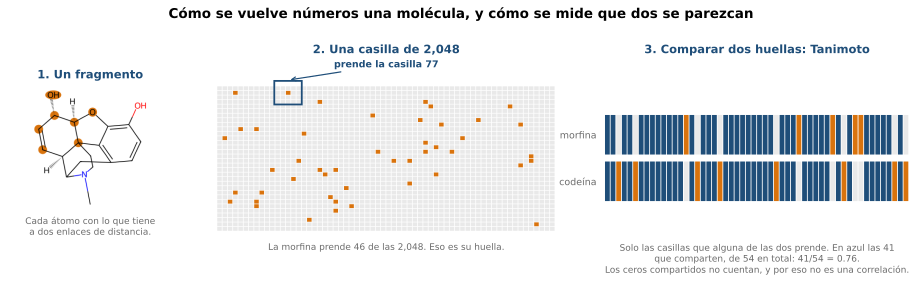{fig-alt="Un fragmento de la morfina prende una casilla de la huella; comparar dos huellas es el Tanimoto"}

- **Descriptores:** propiedades que calcula RDKit (peso, superficie polar, donadores de hidrógeno y doscientas más). Quedan **151**: fuera las casi constantes y las redundantes, elegidas sobre los **valores crudos** para que la selección no cambie si cambia el escalado.
- **Huellas:** las medimos aparte, y ayudan en la fase 2 y en la fase 1 no (respaldo). Los dos modelos finales corren sobre descriptores; en la fase 2 se suma la diana.

::: {.notes}
**Antonio · 0.5 min.** Primero se eligieron las columnas sobre valores crudos, porque cambiar la transformación obligaba a repetir la selección: salen las mismas 151 con las tres. Las huellas medidas son Sort & Slice, con el vocabulario reaprendido dentro de cada pliegue.
:::

## Cómo medimos sin engañarnos {.smaller}

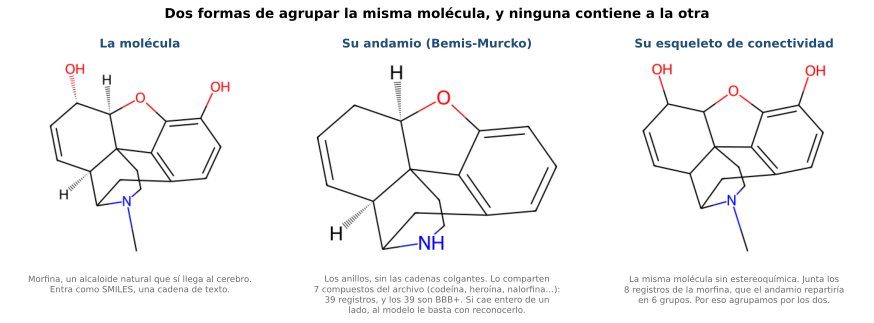{fig-alt="La morfina, su andamio de Bemis-Murcko y su esqueleto de conectividad"}

- **Agrupamos por andamio y por esqueleto, nunca al azar.** Quedan **1,048 grupos**. Partir al azar da cifras demasiado optimistas (Sheridan, 2013): con el `svm_rbf`, el MCC baja de 0.752 con pliegues al azar a 0.702 al agrupar.
- **Qué medimos, y qué dice cada medida. Fase 1**, clasificar: el **MCC** resume en un número los aciertos y los errores de las dos clases, el **AUROC** dice si pone a los permeables por encima sin fijar ningún corte, y el **AUPRC** mira la clase minoritaria. **Fase 2**, predecir potencia: la **concordancia**, que mide si ordena bien los pares.
- Cada prueba se **planteó antes** de ver su resultado, y la prueba reservada solo sirvió **para medir**.

::: {.notes}
**Antonio · 1 min.** El andamio guarda la estereoquímica, así que por sí solo parte en seis los ocho registros de la morfina. El esqueleto es el primer bloque del InChIKey e ignora la estereoquímica. Que partir al azar da cifras demasiado optimistas lo dice la literatura (Sheridan, 2013); la cifra es nuestra: en la escalera de la diapositiva 7, el `svm_rbf` baja de 0.752 de MCC con pliegues al azar a 0.702 al agrupar y a 0.419 en el peldaño de 0.4. Los intervalos remuestrean grupos de moléculas, no filas. Las escalas, si preguntan: el MCC va de −1 a 1 y el azar es 0; el AUROC y la concordancia van de 0 a 1 y el azar es 0.5; el AUPRC va de 0 a 1 pero su piso es la prevalencia de la clase minoritaria, 0.35 en la fase 1. Usamos MCC y no porcentaje de aciertos porque las clases están desbalanceadas: decir «permeable» siempre ya acierta el 63.5%.
:::

## El modelo no es la palanca

- **Permeabilidad: probamos once modelos y todos valen casi lo mismo.** Del mejor al peor hay **4.2 puntos** de MCC, y el mejor **iguala** al modelo sencillo de referencia (0.70) sin superarlo.
- **Potencia: pasa igual.** De los nueve, los siete que compiten de verdad caben en **0.015** de concordancia, que es su propio margen de error.

::: {.callout-tip title="Pista 1"}
No es el modelo.
:::

::: {.notes}
**Antonio · 0.5 min.** Es un resultado negativo honesto en las dos fases: elegir el modelo no fue la palanca. En la prueba reservada el mismo modelo da MCC 0.339 y AUROC 0.793. Medio minuto: el 4.2 lo remata Pame en la siguiente con la escalera al lado, así que aquí basta con dejar la pista. El modelo sencillo de referencia es el baseline del Avance 3, con 0.7019 contra el 0.7017 del final, de ahí que el lift sea cero. En la fase 2 el 0.015 es el rango entre el `bosque` (0.765) y el `boosting` (0.750), y sus desviaciones son de 0.005 a 0.006, de ahí que el rango quepa en el margen de error. **No decir «por descarte» de la fase 2:** ahí el `aft` sí gana el criterio declarado antes de correr, la concordancia en `solo_npass`; lo que no gana es el agregado, y eso lo cuenta Pame.
:::

## La escalera de semejanza · fase 1 {.smaller}

::: {.columns}
::: {.column width="54%"}
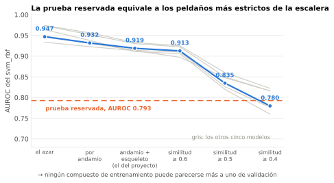{fig-alt="AUROC por peldaño de semejanza permitida entre entrenamiento y validación"}

En azul el `svm_rbf`, el modelo que entregamos; en gris los otros cinco.
:::
::: {.column width="46%"}
| Cómo se parte | Parecido al vecino | MCC |
|:--|--:|--:|
| Al azar | 0.90 | **0.752** |
| Por andamio | 0.75 | 0.721 |
| Andamio + esqueleto | 0.50 | 0.702 |
| Tanimoto < 0.6 | 0.42 | 0.688 |
| Tanimoto < 0.5 | 0.33 | 0.486 |
| Tanimoto < 0.4 | 0.28 | **0.419** |

33 puntos de MCC, contra **4.2** entre los once modelos.
:::
:::

::: {.callout-tip title="Pista 2"}
Importa qué tan nueva es la molécula.
:::

::: {.notes}
**Pame · 1.25 min.** No dividir 33 entre 4.2: son dos estimadores distintos. Agrupar solo por andamio deja el vecino en 0.75, más alto que agrupar solo por esqueleto (0.62): por eso usamos los dos. El esqueleto de conectividad es el primer bloque del InChIKey, la misma molécula ignorando la estereoquímica, así que dos estereoisómeros lo comparten; el andamio es lo contrario, los anillos y sus puentes sin las cadenas colgantes. La escalera de la fase 2 se detiene en 0.6 porque más abajo el 69% y el 90% de los pares caen en un solo grupo. La línea naranja es la prueba reservada, 0.793: cae entre los peldaños de 0.5 y 0.4, y es el puente a la siguiente. Si preguntan por otra definición de parecido: la forma de la caída cambia y el tamaño casi no, 0.419 con ECFP4 contra 0.434 con ECFP6. Que la exactitud dependa de la semejanza con el entrenamiento es un resultado clásico (Sheridan et al., 2004).
:::

## No lo explica, y enseñarle lo raro no ayuda · fase 1 {.smaller}

::: {.columns}
::: {.column width="44%"}
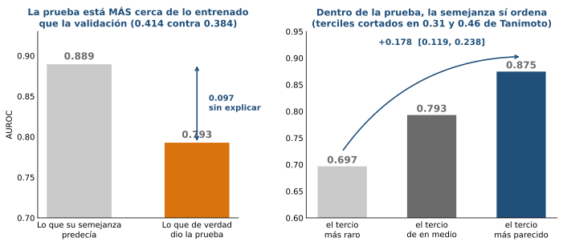{fig-alt="A la izquierda, el AUROC esperado por semejanza contra el real; a la derecha, el AUROC por tercil de semejanza"}

La prueba es **más familiar** que la validación, no más nueva. Debería haber dado 0.889 y dio 0.793.
:::
::: {.column width="56%"}
Tres formas de darle más química rara, las tres con la **regla escrita antes de correr**:

| Qué le dimos | Qué pasó |
|:--|:--|
| **Más peso** a las filas raras que ya tenía | **−0.0005**; los mismos pesos al azar mueven igual |
| **Filas raras de la prueba**, devolviendo comunes | MCC +0.035 pero AUROC **+0.002**: movió el corte |
| **Otra composición** del ajuste, mismo tamaño | **−0.060** con el 25%; con el 75% da igual |

Y de paso, lo más útil: con el mismo modelo y sin reentrenar, las filas **comunes** se miden con AUROC **0.94** y las **raras** con **0.68**.
:::
:::

::: {.callout-tip title="Pista 3"}
La semejanza dice **qué compuestos** serán más difíciles, no **cuánto** cae el conjunto: ordena, pero no calibra. Y recomponer la prueba cambia el número que se reporta, no lo que el modelo sabe.
:::

::: {.notes}
**Pame · 1.25 min.** Dos cosas en una: la semejanza no explica el nivel, y darle más química rara no lo arregla. La prueba está a 0.414 de parecido medio al vecino contra 0.384 de la validación, y por encima en los cinco cuantiles; la barra gris es la validación repesada a la mezcla de la prueba en diez cubetas (0.879 tal cual, 0.889 repesada, 0.793 real, brecha 0.097; con vecino de cinco sale lo mismo, 0.882). Dentro de la prueba los terciles van de 0.70 a 0.87, +0.178 con IC95 [+0.119, +0.238]; por origen la diferencia es +0.223 en los compuestos sin equivalente natural y +0.086 en los naturales exactos, donde el intervalo incluye el cero, y en los análogos estereoquímicos no se puede leer por la regla de los 20 casos. De los tres intentos: el repeso descarta una mejora grande y no una de 0.005 (solo detectaría 0.010); en el segundo los tres brazos separan de dónde sale (filas raras +0.035 en 15 de 15, al azar +0.023 en 13 de 15, quitar solo las comunes −0.001) y tampoco lo explica la prevalencia, que pasa de 65.0% a 64.5%; el tercero lo corrí yo y su estadístico principal incluye el cero, el −0.060 es la lectura equilibrada y es secundaria. El 0.94 y el 0.68 son poblaciones distintas: el 0.94 son las 295 filas comunes que pasaron a la prueba y el 0.68 los raros que se quedaron en el núcleo. Los cuatro candidatos de los 0.097, ninguno medido: prevalencia, peso y polaridad, curación de los datos, y andamios raros reservados a propósito.
:::

## El corte de 0.5 está mal puesto · fase 1 {.smaller}

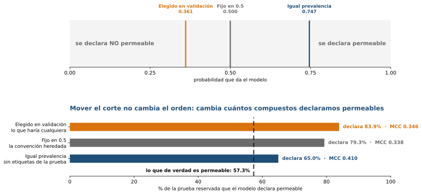{fig-alt="Dónde cae cada corte y qué porcentaje de la prueba declara permeable"}

- Igualar la tasa declarada a una prevalencia supuesta sube el MCC de **0.34 a 0.41**, sin usar etiquetas de la prueba. Y supusimos la prevalencia del ajuste, 65%, cuando era 57%: aguanta el error.
- Elegir el corte con validación **no sirve** (+0.0065): lo mueve hacia abajo, y la prueba lo necesitaba hacia arriba.

**Qué explica la caída:** el corte explica una parte y se puede corregir: recupera 0.07 de los 0.36 de MCC que perdimos. El resto es real: el orden también cayó, 12.6 puntos de AUROC (0.919 a 0.793).

::: {.notes}
**Pame · 1.5 min.** El AUROC es el mismo con cualquier corte (0.793), y es lo que cayó de verdad, de 0.919 en validación. Tres límites: el corte de igual prevalencia necesita el lote completo y suponer una prevalencia, así que para un compuesto suelto no sirve, y por eso el cuaderno entrega la probabilidad y no una clase; el techo de 0.485 usa las etiquetas de la prueba, así que mide el margen y no un resultado; y las dos lecturas salen de una sola apertura de la prueba, con el corte congelado antes de abrirla y controles que reproducen el 0.3385 y el 0.793 ya registrados. Si aprietan con por qué elegir el corte en validación no sirve: el congelado sale 0.361 y la prueba necesitaba 0.747, y la guarda por mitades de grupos elige un corte por debajo de 0.5 en el 78 al 82% de los remuestreos, con ganancia media negativa (−0.002 a −0.003).
:::

## El modelo de potencia · fase 2 {.smaller}

::: {.columns}
::: {.column width="54%"}
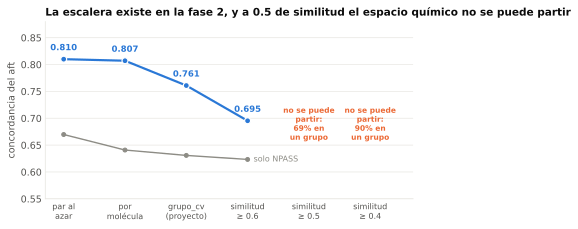{fig-alt="Concordancia del aft por peldaño de semejanza permitida; en gris, solo los pares de NPASS"}

La misma escalera: de 0.807 por molécula a 0.695 con semejanza menor de 0.6. En gris, solo los pares de NPASS.
:::
::: {.column width="46%"}
Predice la **potencia de cada par compuesto-diana**, no una clase. El `aft` aprende de las mediciones **censuradas**, las que solo dicen «menos potente que esto», y que los otros nueve modelos descartan.

| Concordancia | |
|:--|--:|
| Validación cruzada | 0.761 |
| Prueba reservada | **0.720** |
| 117 pares naturales | **0.530** |
| Línea base de peso y TPSA | 0.565 |

Acierta cuál de dos pares es más potente. El azar da 0.5.
:::
:::

::: {.callout-tip title="Pista 4"}
El agregado lo domina ChEMBL. En productos naturales el orden de potencia **no está demostrado**.
:::

::: {.notes}
**Pame · 1 min.** Elegimos el `aft` justamente por los naturales: en los pares que solo tiene NPASS su concordancia en validación es 0.632 contra 0.511 del bosque, porque aprende de las censuradas que los demás tiran. En la prueba esos pares dan 0.530 y con 117 no hay potencia para distinguir 0.511 de 0.632: no refuta ni confirma, y por eso se dice «no demostrado» y no «falla». La escalera se detiene en 0.6 porque más abajo el 69% y el 90% de los pares caen en un solo grupo. Si preguntan por la base externa de la patrocinadora: 0.792 en 8,134 pares con el modelo guardado y sin reentrenar, mejor que nuestra prueba, pero no es comparable porque el 64.9% de sus pares tiene un andamio ya visto. Y un aviso que conviene decir: el orden global mide sobre todo **qué diana es**; en el ajuste, un control que solo usa la diana llega a 1.36 de enriquecimiento contra un techo de 1.40.
:::

## Qué mide de verdad · fase 2 {.smaller}

- **La diana manda.** El enriquecimiento del `aft` ya está en el techo (1.40 con 71.4% de activos) y un control que **solo usa la diana** llega a 1.36: el orden global mide sobre todo **qué diana es**, no qué molécula.
- **La procedencia lleva señal de la etiqueta.** En la versión de clasificación, un modelo que solo ve **de dónde viene** el compuesto, sin mirar la molécula, llega a 0.280 de MCC: el **65%** de lo que logra la química (0.428). Por eso cada métrica se reporta por procedencia y no solo en agregado.
- **Su base externa, la que nos dio el equipo de la patrocinadora.** Con el modelo guardado y sin reentrenar: concordancia **0.792** en 8,134 pares (0.667 en los 249 que solo tiene NPASS). Mejor que nuestra prueba, y **no comparable**: se separó por compuesto y no por andamio, y el **64.9%** de sus pares tiene un andamio que el modelo ya vio.

::: {.notes}
**Pame · 0.75 min.** Es la diapositiva de las salvedades de la fase 2, y las tres apuntan al mismo sitio: el agregado promete más de lo que el modelo sabe de una molécula nueva. El enriquecimiento al 1% está en el techo porque la tasa base es del 71.4%, así que ahí no discrimina y se lee mejor la precisión en los primeros 100. El dato de la procedencia es de la tarea de clasificación a 10 µM, no de la regresión, y conviene decirlo así; la química le gana por 0.148 de MCC, pero que una columna de tres valores llegue al 65% dice que la fuente lleva señal de la etiqueta. Y la base externa es la buena noticia con asterisco: su cifra es alta porque su partición es por compuesto, así que no mide química nueva. Si preguntan qué haría falta: medir la potencia con sus propios lotes, que es lo que pide el trabajo futuro.
:::

## Qué pesa en cada fase {.smaller}

{fig-alt="Gráfico de puntos de SHAP: cada punto es un compuesto, su posición es el efecto de la columna en la predicción y su color el valor de la columna"}

- **Cómo se lee:** cada punto es un compuesto (en la fase 2, un par compuesto-diana); a la derecha, esa columna **sube** la predicción, y el color es su valor.
- **Dos métodos:** SHAP reparte cada predicción entre las columnas; la **permutación** baraja una columna y mide cuánto empeora el modelo. «Confirmada» es que las dos la ponen entre sus 15 primeras.
- **Fase 1:** una **lactama** o más **donadores de hidrógeno** bajan la probabilidad de cruzar la barrera; TPSA no domina.
- **Fase 2:** las columnas `diana:` no son química: dicen **qué diana es** (MAOA baja la potencia predicha, LRRK2 la sube) y suman el **15%** de la atribución. El resto es química, sobre todo **complejidad** (`BertzCT`), y es **casi la misma en todas las dianas**. **No afirmamos ningún mecanismo.**

::: {.notes}
**Art · 0.75 min.** Dos métodos independientes. SHAP mira dentro del modelo y dice cuánto empuja cada columna cada predicción, y en qué dirección. La permutación solo mira la salida: baraja una columna, para que deje de tener relación con la respuesta, y mide cuánto empeora el modelo; no da dirección, y subestima a las columnas redundantes, como TPSA. "Confirmada por permutación" es lo que los dos ponen entre sus quince primeros. En la fase 1 coinciden en seis descriptores; en la 2, en doce de quince. Los puntos son 300 compuestos en la fase 1 y 3,000 pares compuesto-diana en la 2 (una muestra de las filas de validación). En la fase 2 la diana entra al modelo como 26 columnas 0 o 1, y en un ranking global aparecen mezcladas con la química; por eso en el respaldo las separamos: cuánto pone la diana (15% de la atribución) y qué química pesa dentro de cada una. El detalle está en el respaldo.
:::

## El cuaderno 06: usar los modelos con tus compuestos {.smaller}

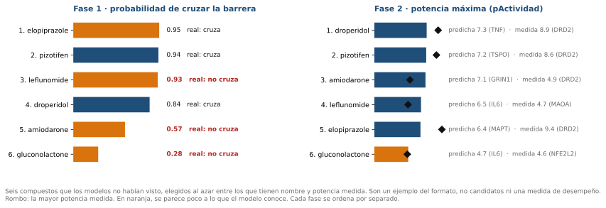{fig-alt="Ranking por fase de seis compuestos de la prueba reservada: probabilidad de cruzar la barrera junto a la etiqueta real, y potencia máxima predicha junto a la medida" width="85%"}

- **Qué es:** `notebooks/06_Uso_de_los_modelos.ipynb`. Le das **SMILES propios** y devuelve, por compuesto, la probabilidad de cruzar la barrera, la potencia por diana y una **advertencia de extrapolación**. No hay servicio.
- **Qué se ve:** su salida para seis compuestos de la **prueba reservada**, que ningún modelo vio, sorteados sin escoger y **ordenados por fase**. A la izquierda, la probabilidad de cruzar la barrera junto a la etiqueta real; a la derecha, la potencia predicha (barra) y la medida (rombo).
- **Lo que enseña:** la leflunomida sale con 0.93 y **no cruza**, y la diana de mayor potencia predicha no coincide con la medida en ninguno de los seis.
- **No combina** las fases en un solo ranking (queda como trabajo futuro); seis ejemplos para ver el formato, **ni lista de candidatos ni métrica**.

::: {.notes}
**Art · 0.5 min.** Es el cuaderno que usa la patrocinadora. Los seis compuestos son de la prueba reservada, sorteados con semilla 0: ningún modelo los vio, y no son una métrica. A la izquierda, la leflunomida sale con 0.93 y no cruza la barrera; a la derecha, el rombo es la potencia medida y la diana predicha no coincide con la medida en ninguno. En naranja, similitud menor de 0.4 con lo que el modelo vio en esa fase.
:::

## La lista priorizada: qué probar primero {.smaller}

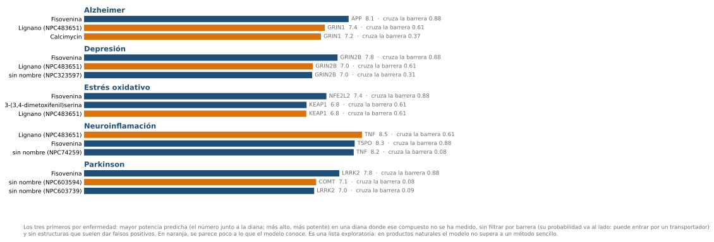{fig-alt="Los tres primeros compuestos naturales de cada enfermedad, con su diana, la potencia predicha y la probabilidad de cruzar la barrera" width="80%"}

- **Qué es:** los naturales con mayor potencia predicha por enfermedad y por diana, **sin medición** contra esa diana, con **barrera probable** y sin alerta PAINS (752 candidatos de 1,821 de NPASS y CMAUP). Completa en el sitio (*Entrega final*) y en CSV.
- **Cómo leerla:** es **exploratoria**. El modelo de potencia **no supera a una línea base** en naturales (0.530 contra 0.565): sirve para decidir qué probar primero, no como resultado.
- **Se repite:** 84 compuestos distintos en 260 lugares, porque la química que pesa es casi la misma en todas las dianas.

::: {.notes}
**Art · 0.5 min.** Es el objetivo con el que abrimos: priorizar naturales que lleguen al cerebro y actúen sobre su diana. La figura trae los tres primeros por enfermedad; la lista completa, por diana y por enfermedad, está en el sitio. Es una lista de hipótesis para el laboratorio: el modelo de potencia no supera a una línea base en naturales, y combinar las dos fases no está validado, así que el criterio de barrera solo ordena y no descarta. En naranja, compuestos lejos de lo que el modelo vio. Los identificadores NPASS:NPC son compuestos de esa base sin un nombre usable en el dato.
:::

## Qué concluimos {.smaller}

::: {.columns .align-center}
::: {.column width="50%"}
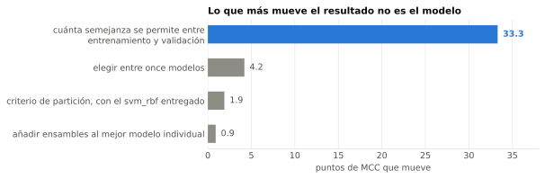{fig-alt="Fase 1: orden de magnitud de los factores que mueven el desempeño"}
:::
::: {.column width="50%"}
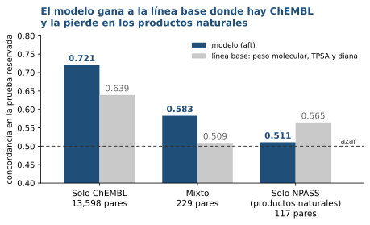{fig-alt="Fase 2: concordancia del modelo y de una línea base por procedencia de los datos"}
:::
:::

- **Fase 1, permeabilidad:** el MCC cae de 0.70 a 0.34. Unos **0.07 son el corte**, que se ajusta (0.34 a 0.41). El resto es que el **orden empeoró**: el AUROC, que mide qué tan bien se ordenan los compuestos sin fijar un corte, baja de 0.919 a 0.793, **12.6 puntos**: unos 3 son lo que la semejanza de la prueba predecía (0.89); los otros 10 **no los explicamos**.
- **Fase 2, potencia:** el modelo acierta el orden en el 72%, pero lo domina ChEMBL. En los **117 pares de productos naturales** pierde contra una línea base sencilla: **no está demostrado**.
- **En las dos:** la confianza en una predicción depende de **qué tan nueva es la molécula**, no del modelo.
- **Límites:** una sola prueba y un modelo por fase. **Siguiente:** combinar las fases en un orden, y medir la potencia con lotes propios.

::: {.notes}
**Art · 1.5 min.** Lo nuevo es la figura de la derecha. A la izquierda, lo que más mueve el MCC de la fase 1, como vimos: la semejanza que se permite, no el modelo. A la derecha, la fase 2 en la prueba por procedencia: con ChEMBL el modelo supera a una línea base sencilla, y en los 117 pares de productos naturales no. La cifra citable es la de la corrida registrada, 0.530; la figura muestra 0.511, del reajuste que mide modelo y línea base en la misma corrida (la línea base da 0.565). El 72% de arriba es el agregado. Si preguntan por los 12.6 puntos del AUROC, se repasaron en «Pero no lo explica todo».
:::

# Respaldo

## Las huellas ayudan en una fase y no en la otra {.smaller}

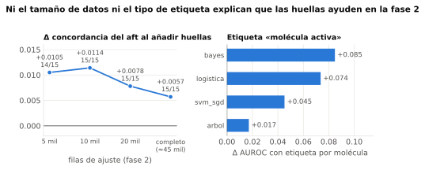{fig-alt="Las huellas ayudan aunque se achiquen los datos o se cambie la etiqueta" width="55%"}

- Ayudan a cinco de seis modelos en la fase 2 y a ninguno en la fase 1.
- No es el tamaño de los datos ni el tipo de etiqueta.

## La ventaja sobre la línea base, por tercil {.smaller}

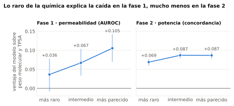{fig-alt="Ventaja del modelo sobre la línea base de peso y TPSA, por tercil de rareza"}

La ventaja del modelo sobre una línea base de peso y TPSA crece con lo parecido que es el compuesto: +0.036 en el tercil más raro y +0.106 en el más parecido (IC95% de la diferencia: 0.011 a 0.124). En la fase 2 la diferencia es cuatro veces menor.

::: {.notes}
**Pame.** Salió del hilo porque mide la ventaja sobre la línea base y la diapositiva 8 habla de AUROC: dos cantidades distintas en la misma pantalla confunden.
:::

## El modelo de potencia en NPASS {.smaller}

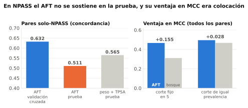{fig-alt="Concordancia solo NPASS y ventaja en MCC del AFT sobre el bosque" width="55%"}

- 117 pares: concordancia 0.530 en la prueba contra 0.632 en validación.
- Con 117 pares no hay potencia: **ni refuta ni confirma**.

## Cómo preparamos las columnas y qué significan las banderas {.smaller}

::: {.columns}
::: {.column width="50%"}
### Las columnas

- Probamos **tres transformaciones** (estandarización, min–max y Yeo-Johnson): salen las mismas **151** columnas con las tres, porque la selección se hace sobre los valores crudos.
- Se quitan las **casi constantes** (un valor domina) y las **redundantes** (correlación de Spearman muy alta).
- Las huellas son bits que marcan fragmentos; el vocabulario se reaprende **dentro de cada pliegue**.
:::
::: {.column width="50%"}
### Las banderas

- **Origen**, del cruce con COCONUT: *natural exacto* (coincidencia exacta), *análogo estereoquímico* (mismo esqueleto) y *sin equivalente natural*.
- **Activo**: potencia a 10 µM o menos. Guardamos el **intervalo de potencia**, no la etiqueta, y las mediciones censuradas cuentan.
- **Grupo A a D** del archivo: indica de qué tipo de dato salió la etiqueta, **no es una escala de calidad** (en regresión, A es el de menos respaldo). Sirve para estratificar, **nunca para excluir**.
:::
:::

::: {.notes}
**Antonio · respaldo.** Para quien pregunte cómo se llega de la molécula a la columna y qué quiere decir cada etiqueta. El origen se usa en los resultados (la ventaja por tercil de rareza se reporta por origen). El corte de 10 µM viene del cribado original y es una decisión que puede cambiar, por eso se guarda el intervalo. El grupo A a D no es una escala: filtrar a A y B baja la clase minoritaria de 36.5% a 27.0%, así que empeora el desbalance en lugar de quitar ruido.
:::

## Qué pesa en cada fase: el detalle {.smaller}

::: {.columns}
::: {.column width="50%"}
### Fase 1 · permeabilidad

- Dos métodos (permutación, que baraja una columna y mide cuánto empeora el modelo, y KernelSHAP) coinciden en seis descriptores: `fr_lactam`, `NumHDonors` (puesto 4 en ambos), `NumAliphaticCarbocycles`, `VSA_EState3`, `fr_Ar_OH` y `fr_ether`.
- **TPSA no domina**: puesto 40 por permutación y 10 por SHAP, porque comparte información con otras columnas.
:::
::: {.column width="50%"}
### Fase 2 · potencia

- TreeSHAP y permutación concuerdan (Spearman 0.93). Pesa la **diana** (`MAOA`, `MAOB`, `DRD2`, `LRRK2`, `BCHE`: el 15% de la atribución), la complejidad topológica (`BertzCT`), la lipofilia y los halógenos.
- TPSA y los donadores de hidrógeno, que dominan la permeabilidad, quedan lejos: lugares 44 y 165.
:::
:::

**No afirmamos ningún mecanismo:** son nombres de columna. Por subestructura solo salen heterociclos nitrogenados, genéricos.

::: {.notes}
**Respaldo.** Pame contesta la fase 1 y Antonio la 2. Es para quien pregunte qué mira el modelo. Lo que importa en una fase no sirve en la otra: los donadores de hidrógeno son cuartos en la permeabilidad y quedan en el lugar 165 en la potencia. Corridas: `2026-11-04-artemio-C.2-atribucion-fase1-svm-dos-metodos` y `2026-11-04-artemio-2.13-atribucion-aft-treeshap-y-permutacion`.
:::

## Fase 2: la diana y la química, por separado {.smaller}

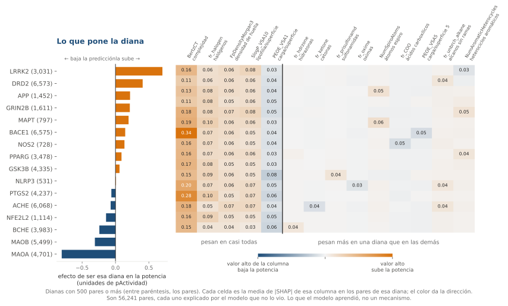{fig-alt="A la izquierda, cuánto sube o baja la potencia predicha ser cada diana; a la derecha, cuánto pesa cada columna química en los pares de cada diana"}

- **La diana pone el punto de partida.** Entre las 16 dianas con 500 pares o más, ser LRRK2 sube la potencia predicha unas 0.7 unidades de pActividad y ser MAOA la baja unas 0.8. Las columnas de diana son el 15% de la atribución.
- **La química que pesa es casi la misma en todas.** El orden de las columnas coincide entre dianas (Spearman mediano 0.94, mínimo 0.90): complejidad, halógenos, huella y lipofilia.
- **Lo que distingue a una diana pesa poco** (0.03 a 0.06 contra 0.11 a 0.34 de la complejidad): hidrazonas en MAOA, sulfonamidas en PTGS2, cetonas en BCHE. **Solo SHAP: la permutación no las confirma** (puestos 57 a 108 en la permutación). Es lo que aprendió el modelo, no un mecanismo.

::: {.notes}
**Respaldo · Antonio.** Contesta «¿para cada diana, qué química importa?». La diana entra al modelo como 26 columnas 0 o 1, así que un ranking global la mezcla con los descriptores; aquí se separan. Se explican las 56,241 filas, cada una con el modelo que no la vio (en el resto de la presentación son 3,000 de muestra). Izquierda: la suma del SHAP de las columnas de diana de cada par, promediada por diana. Derecha: media de |SHAP| de cada columna en los pares de esa diana; naranja, un valor alto de la columna sube la potencia; azul, la baja. Lo que sale: casi toda la química es común, y las columnas propias de una diana son fragmentos poco frecuentes, de modo que pueden reflejar qué tipo de compuestos se midió contra esa diana y no cómo actúan. Además solo las ve SHAP: la permutación no las confirma, y la C.2 pide lo que coincide en dos métodos. Las dianas con menos de 500 pares no se interpretan. Corrida: `2026-11-12-artemio-C.2-shap-por-diana-fase2`.

:::

## Una herramienta para medir columnas nuevas {.smaller}

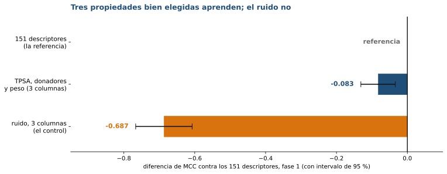{fig-alt="Diferencia de MCC contra los 151 descriptores: tres propiedades bien elegidas quedan unos 0.08 por debajo y un control de ruido casi 0.69 por debajo"}

- Una tabla de **columnas propias** se compara contra los descriptores con la **misma validación agrupada** y contra un **control de ruido**.
- Ejemplo: tres propiedades de la literatura quedan **unos 0.08 de MCC** por debajo de los 151 descriptores, y el ruido casi 0.69. Aprenden, pero no igualan.
- **Dónde está:** el módulo `src/models/representaciones.py` del repositorio, con su guía en el sitio (*Entrega final*, «Medir una representación nueva»). Es Python, no una interfaz.

::: {.notes}
**Respaldo · Art.** Es la parte del proyecto que sirve más allá de nuestros modelos: cualquiera puede medir si unas columnas nuevas ayudan, sin engañarse. Se usa con tres funciones: `con_tabla` para traer las columnas propias, `columnas_al_azar` para el control de ruido y `comparar` para medir con la misma validación; la guía dice cómo agrupar y qué errores evitar.
:::
